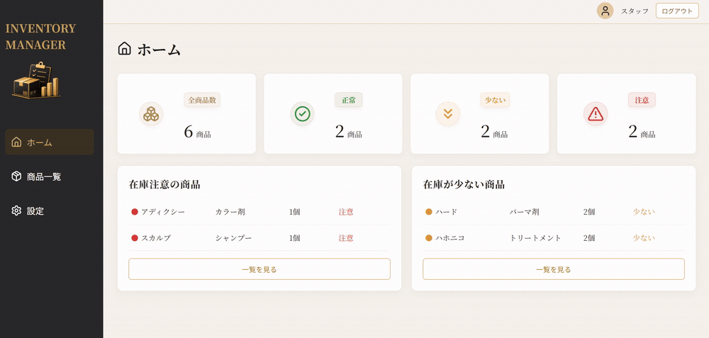
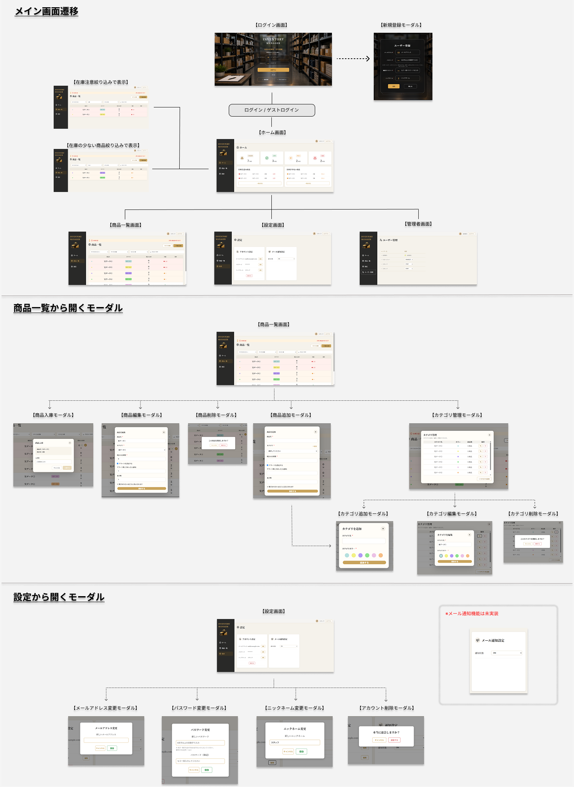
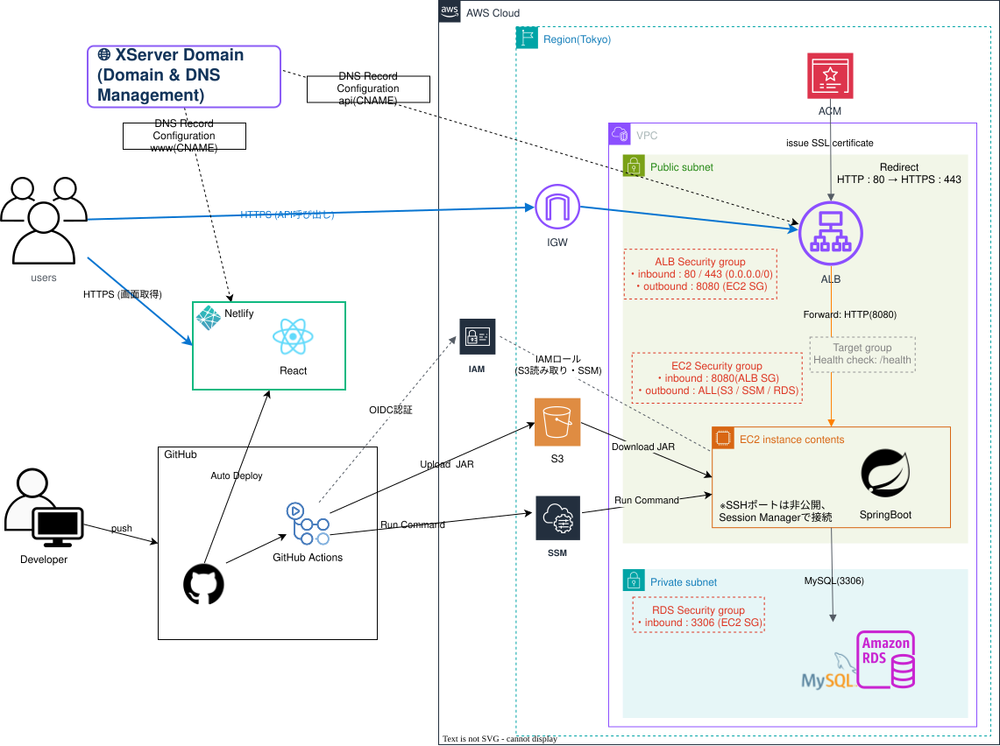
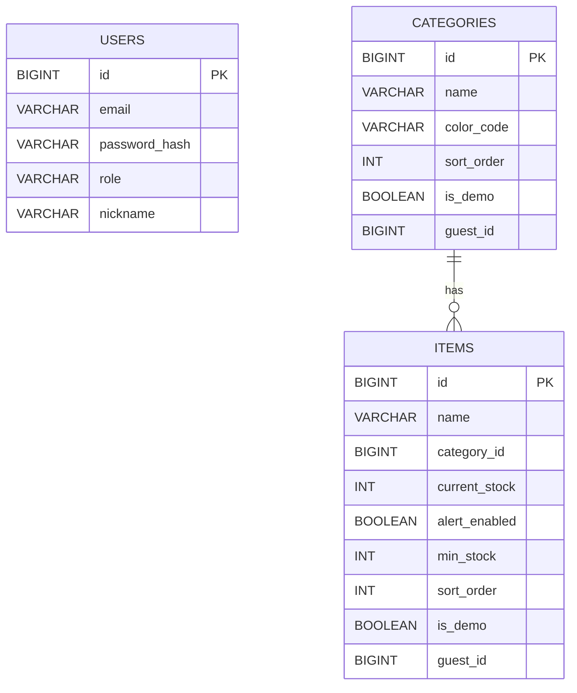
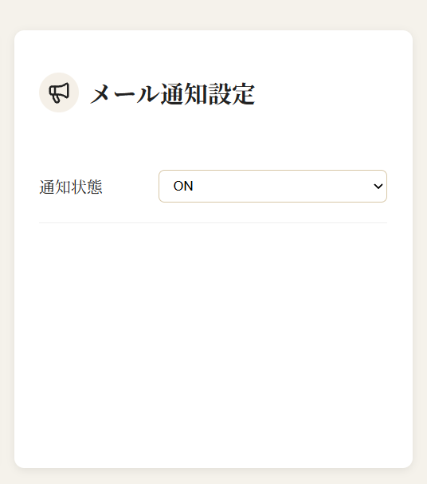

# INVENTORYMANAGER


## 🔗アプリURL
[INVENTORY MANAGER](https://inventory-manager-app.com)

## 📌 目次
- [概要](#概要)
- [制作背景](#制作背景)
- [要件定義](#要件定義)
- [主な機能](#主な機能)
- [主な使用技術](#主な使用技術)
- [️技術選定理由](#技術選定理由)
- [️画面遷移図](#画面遷移図)
- [インフラ構成図](#インフラ構成図)
- [DB設計](#DB設計)
- [ER図](#ER図)
- [APIのURL設計](#APIのURL設計)
- [工夫した点](#工夫した点)
- [苦労した点](#苦労した点)
- [今後の実装予定](#今後の実装予定)

## 🔎概要
店舗で使用する商品の在庫を管理するWebアプリです。

商品ごとの在庫数を簡単に確認・更新できるほか、
設定した基準値を下回った商品を在庫注意として確認できるようにすることで、
発注が必要な商品の見落としを防ぎ、店舗の在庫管理を効率化します。

## 🎯制作背景
美容師として働く中で、在庫確認や発注作業に手間がかかることに加え、
在庫が少なくなっていることに気づくのが遅れ、
商品が必要になったタイミングで在庫切れが発覚し、その際に他店舗へ
商品を借りに行くこともあり、在庫管理の非効率さを課題に感じていました。

そこで、商品の在庫数を簡単に確認・更新でき、
在庫が少なくなった商品を把握できる在庫管理アプリを制作しました。

## 📝要件定義
- 目的 : 店舗の在庫を把握し、在庫不足を防止する
- 想定ユーザー : 店舗の管理者 / マネージャー / スタッフ

詳細は[要件定義書](docs/要件定義書.md)を参照ください。

## ⚙️主な機能
- 商品の登録・編集・削除
- 商品一覧の表示・並び替え・検索
- 在庫数の増減・更新
- 在庫状況の確認
- ユーザー登録とログイン・ログアウト機能
- ユーザー設定（メールアドレス・パスワード・ニックネーム変更）
- ロール別権限管理(管理者のみ)
- ゲストログインによるデモ操作

## 🔧主な使用技術

### バックエンド
- Java 21 / Spring Boot 4.1.0

### フロントエンド
- React 19.2.8 / Node.js 24.19.0 / JavaScript / CSS

### インフラ・DB
AWS 
- Amazon VPC (仮想ネットワーク)
- Amazon EC2 (Amazon Linux 2023)
- Amazon RDS for MySQL (データベース)
- Amazon S3 (JARファイルの保存)
- AWS Systems Manager (コマンド実行・EC2接続)
- Elastic Load Balancer (ALB：HTTPS終端・EC2への転送・HTTPからHTTPSへのリダイレクト)
- AWS Certificate Manager (SSL証明書の発行・管理)
- AWS IAM (アクセス権限管理)

その他
- Netlify (フロントエンドのホスティング・自動デプロイ)
- XServer Domain (ドメイン・DNS設定)
- MySQL (ローカル開発環境)

### 認証・認可
- Spring Security

### データアクセス
- Spring Data JPA

### 開発環境・ツール
- Postman
- Git
- GitHub
- GitHub Actions
- Visual Studio Code / IntelliJ IDEA

## 🏷️技術選定理由

### Spring Boot
Javaでのバックエンド開発を学習することを目的として採用しました。
またSpring Bootを通してREST APIの構築や、
Spring Securityを利用した認証・認可の仕組みを理解したいと考え採用しました。

### React
フロントエンド技術について調べる中で、Reactが広く利用されていることを知り、
実務で使用される機会が多い技術を学びたいと考え採用しました。
またコンポーネント単位でUIを管理できるため、
商品一覧やモーダルなどを整理しやすくなると思ったのも採用理由です。

## 🗺️画面遷移図
アプリ全体の画面遷移と、各画面から開くモーダルをまとめています。


## 🟣インフラ構成図


## 🔵DB設計
### users
| カラム           | 内容           |
|---------------|--------------|
| id            | 主キー          |
| email         | メールアドレス      |
| password_hash | ハッシュ化したパスワード |
| role          | 権限           |
| nickname      | ニックネーム       |

### categories
| カラム        | 内容      |
|------------|---------|
| id         | 主キー     |
| name       | カテゴリ名   |
| color_code | カテゴリカラー |
| sort_order | 表示順     |
| is_demo  | デモデータかどうか |
| guest_id | ゲストユーザーID |

### items
| カラム           | 内容         |
|---------------|------------|
| id            | 主キー        |
| name          | 商品名        |
| category_id   | カテゴリID     |
| current_stock | 現在の在庫数     |
| alert_enabled | アラートON/OFF |
| min_stock     | アラート基準値    |
| sort_order    | 商品の並び順     |
| is_demo  | デモデータかどうか |
| guest_id | ゲストユーザーID |

## 🟡ER図

###### ※単一店舗での利用を想定しているため、通常の商品・カテゴリは店舗内で共有して管理します。一方、Web上でのデモ利用では複数ユーザーが同時に利用する可能性を考慮し、 is_demo と guest_id によってゲストごとのデモデータを分離しています。

### 認証方式
Spring Securityによるセッション認証を使用しています。
ログイン時に認証情報をセッションに保存し、
以降のAPIリクエストではセッションCookieを利用して認証状態を管理します。
パスワードはBCryptでハッシュ化して保存しています。

## 🟢APIのURL設計
### 商品API
| HTTPメソッド | URL | 処理内容 |
|---|---|---|
| GET | `/api/items` | 商品一覧取得 |
| POST | `/api/items` | 商品登録 |
| PUT | `/api/items/{id}` | 商品更新 |
| DELETE | `/api/items/{id}` | 商品削除 |
| PATCH | `/api/items/{id}/stock` | 在庫数更新 |

### カテゴリAPI
| HTTPメソッド | URL | 処理内容 |
|---|---|---|
| GET | `/api/categories` | カテゴリー一覧取得 |
| POST | `/api/categories` | カテゴリー登録 |
| PUT | `/api/categories/{id}` | カテゴリー更新 |
| DELETE | `/api/categories/{id}` | カテゴリー削除 |

### 認証・ユーザーAPI
| HTTPメソッド | URL                   | 処理内容    |
|---|-----------------------|---------|
| POST | `/api/auth/login`     | ログイン    |
| POST | `/api/auth/logout`    | ログアウト   |
| POST | `/api/auth/register`  | ユーザー登録  |
| PATCH | `/api/auth/email`     | メールアドレス変更 |
| PATCH | `/api/auth/password`  | パスワード変更 |
| PATCH | `/api/auth/nickname`  | ニックネーム変更 |
| PATCH | `/api/auth/{id}/role` | ユーザー権限変更 |
| GET | `/api/auth/users`     | ユーザー一覧取得|
| DELETE | `/api/auth`           | ユーザー削除  |


### ゲストAPI
| HTTPメソッド | URL | 処理内容 |
|---|---|---|
| POST | `/api/guest/login` | ゲストログイン |
| POST | `/api/guest/logout` | ゲストログアウト |

## 💡工夫した点
### 在庫数を直感的に確認できるUI
在庫数だけでなく、在庫状況を視覚的に把握できるように、
在庫数に応じて表示を変えるUIを実装しました。
在庫状況を「正常」「少ない」「注意」の3段階で視覚的に把握できるようにしています。

### 誤操作を防ぐ在庫変更
在庫数を増減する操作では、変更内容を確認してから確定できるようにし、
誤操作による在庫数の変更を防止しています。

<details>
<summary>👇実装コード</summary>

```javascript
const [stockChange, setStockChange] = useState(0);

const handleStockChange = async (item, newStock) => {
  const updatedStock = await updateStockApi(item, newStock);

  onUpdateStock(updatedStock);
};
// ...

// 在庫を減らす
setStockChange((prev) => Math.max(prev - 1, -item.currentStock));
// ...

// 在庫を増やす
setStockChange((prev) => prev + 1);
// ...

// 決定ボタンで変更を確定
if (stockChange !== 0) {
              handleStockChange(item, item.currentStock + stockChange);
   }
// ...
```
</details>

### ゲストログイン機能
閲覧するユーザーがすぐにアプリを体験できるよう、 ゲストログイン機能を実装しました。

ゲストログイン時にはゲストユーザーごとにゲストアカウントとデモデータを作成し、
商品・カテゴリにゲストユーザーIDを紐づけることで、
複数のゲストユーザーが同時に利用してもデータが干渉しないようにしています。

<details>
<summary>👇実装コード</summary>

```java
public void createDemoData(Long guestId) {
  Map<Long, Category> categoryMap = createDemoCategories(guestId);

  createDemoItems(categoryMap, guestId);
}

private Map<Long, Category> createDemoCategories(Long guestId) {
  // 実際のデータのカテゴリを取得
  List<Category> realCategories = 
      categoryRepository.findAllByIsDemoAndGuestId(false, null);

  List<Category> demoCategories = new ArrayList<>();
  Map<Long, Category> categoryMap = new HashMap<>();

  for (Category realCategory : realCategories) {
    Category demoCategory = new Category();

    demoCategory.setName(realCategory.getName());
    demoCategory.setColorCode(realCategory.getColorCode());
    
    // ゲストごとのデモデータとして登録
    demoCategory.setIsDemo(true);
    demoCategory.setGuestId(guestId);

    demoCategories.add(demoCategory);
    
    // 元カテゴリIDとデモカテゴリを対応付け
    categoryMap.put(realCategory.getId(), demoCategory);
  }
  categoryRepository.saveAll(demoCategories);
  return categoryMap;
}

private void createDemoItems(Map<Long, Category> categoryMap, Long guestId) {
  // 実際のデータの商品を取得
  List<Item> realItems = 
      itemRepository.findAllByIsDemoAndGuestIdOrderBySortOrderAsc(false, null);

  List<Item> demoItems = new ArrayList<>();

  for (Item realItem : realItems) {
    Item demoItem = new Item();

    demoItem.setName(realItem.getName());
    demoItem.setCurrentStock(realItem.getCurrentStock());
    demoItem.setAlertEnabled(realItem.getAlertEnabled());
    demoItem.setMinStock(realItem.getMinStock());
    demoItem.setSortOrder(realItem.getSortOrder());
    demoItem.setIsDemo(true);
    demoItem.setGuestId(guestId);
    
    // ゲスト用カテゴリに紐付け
    Category demoCategory = categoryMap.get(realItem.getCategory().getId());

    demoItem.setCategory(demoCategory);

    demoItems.add(demoItem);
  }

  itemRepository.saveAll(demoItems);
}
```
</details>


### ゲストデータの削除機能
ゲストログアウト時には、対象のゲストIDに紐づく
デモ商品・デモカテゴリ・ゲストアカウントを削除し、不要なデータが残らないようにしています。
また、一定時間アクセスがないゲストについても、
最終アクセス日時をもとにデータを削除する仕組みにしました。

#### 1. 削除処理
<details>
<summary>👇実装コード</summary>

```java
// ログアウト時に、現在のゲストのデモデータとアカウントを削除
@Transactional
public void deleteCurrentGuestData() {
  // 現在ログインしているゲストのIDを取得
  Long guestId = getCurrentGuestId();

  deleteDemoData(guestId);
}

@Transactional
public void cleanupExpiredGuest() {
  // 30分前の日時を取得
  LocalDateTime threshold = LocalDateTime.now().minusMinutes(30);

  // 最終アクセスから30分以上経過したゲストを取得
  List<Users> expiredGuest =
      usersRepository.findByRoleAndLastAccessedAtBefore("GUEST", threshold);
  
  // 対象ゲストごとにデモデータとアカウントを削除
  for (Users guest : expiredGuest) {
    deleteDemoData(guest.getId());
  }
}

@Transactional
public void deleteDemoData(Long guestId) {
  // 対象ゲストの商品を削除
  itemRepository.deleteAllByIsDemoAndGuestId(true, guestId);
  
  // 対象ゲストのカテゴリを削除
  categoryRepository.deleteAllByIsDemoAndGuestId(true, guestId);
  
  // ゲストアカウントを削除
  usersRepository.deleteById(guestId);
}
```
</details>

#### 2. 定期実行処理
<details>
<summary>👇実装コード</summary>

```java
// 期限切れゲストの削除処理を定期実行する
@Component
@RequiredArgsConstructor
public class GuestCleanupScheduler {

  private final GuestService guestService;
  // 10分ごとに期限切れゲストの削除処理を実行
  @Scheduled(fixedRate = 10 * 60 * 1000)
  public void cleanupExpiredGuest() {
    guestService.cleanupExpiredGuest();
  }
}
```
</details>

### 効果的なバリデーションと例外処理
#### 1. フロントとバックエンドの二重バリデーション
- フロントエンド : 新規登録・メールアドレス変更・パスワード変更で、メール形式とパスワード形式を正規表現で送信前にチェックし、
必須項目の未入力、パスワードと確認用の不一致も検出できるようにしました。


- バックエンド : Bean Validation(`@NotBlank` / `@Pattern` / `@Min` / `@Valid`)で、
APIに直接リクエストされた場合にも不正な入力を防止するようにしました。

#### 2. 状況に応じたHTTPステータスの使い分け
- 想定される例外を適切なHTTPステータスコードに変換し、
  エラーの種類に応じたレスポンスを返すようにしました。

| ステータス | 用途                                                                                       |
|---|------------------------------------------------------------------------------------------|
| 400 | 入力値の形式不正・必須項目の未入力((Bean Validation)                                                      |
| 401 | 未ログイン・認証失敗・セッション切れ                                                                       |
| 403 | ロールによる権限不足                                                                               |
| 404 | 対象の商品・カテゴリ・ユーザーが存在しない                                                                    |
| 409 | 商品名・カテゴリ名・メールアドレスの重複<br/>商品が登録されているカテゴリの削除<br/>現在と同じパスワードへの変更<br/>すでに管理者がいる状態での管理者への権限変更 <br/>既存管理者の権限変更|
| 422 | 新規登録時のパスワードと確認用の不一致                                                                      |
#### 3. エラーメッセージの表示と認証エラーへの対応
- HTTPステータスコードに応じて、フロントエンドではエラーメッセージを表示するようにしました。
また、セッション切れなどで認証エラーが発生した場合は、
ログイン状態を解除してログイン画面へ切り替え、再ログインを促すようにしました。

## 🚨苦労した点
### 画面構成の見直し
#### 【問題】
はじめは、商品一覧画面のみの構成で設計していましたが、
商品一覧画面を作り終えて実際に自分で使ってみると、
在庫が少ない商品状況の確認やユーザー設定などの機能を商品一覧画面だけで管理するよりも、
画面を分けたほうが使いやすいと感じました。

#### 【解決策】
商品一覧画面だけでなく、ホーム画面・商品一覧・設定・ユーザー管理(adminのみ)の
4画面に分け、各画面へ移動しやすいようにサイドバーを追加しました。

### ゲストログインの設計変更
#### 【問題】
はじめは、1つのゲストアカウントを複数のユーザーで共有する設計にしていました。

ですが、Web上で公開することを考えると、 複数のユーザーが同時にゲストログインした場合、
同じデータを操作することでデータが干渉する可能性があると思いました。

#### 【解決策】
ゲストログインするたびにゲストアカウントを作成し、 ゲストユーザーごとにデモデータを作成する設計へ変更しました。

商品・カテゴリにゲストユーザーIDを紐づけることで、
複数のゲストユーザーが同時に利用しても、それぞれ独立したデモデータを操作できるようにしました。

また、ログアウト時にはゲストユーザーと紐づくデモデータを削除することで、
不要なデータが残らないようにしています。

### Spring Security導入後のエラー処理
#### 【問題】
ユーザー登録・ログイン時のエラーを、状況に応じて適切なHTTPステータス（409・401・400）として返すようにしましたが、
まずメールアドレス重複時に409 Conflictを返す実装をしたところ、実際には403 Forbiddenが返る問題が発生しました。

#### 【原因】
メールアドレス重複時だけでなく、ログイン認証失敗時や新規登録時の入力エラーでも403 Forbiddenが返っていたため、
まずCSRFを無効にして検証しましたが、403は解消されませんでした。
そこで、Spring Securityの詳細ログを有効にし、アクセス制御の処理を調べました。
その結果、 エラー処理後の/errorへのアクセスが拒否されていることが分かりました。

#### 【解決策】
/errorをpermitAll()の対象に追加することで、エラー処理時のアクセス拒否を解消しました。
その結果、状況に応じて適切なHTTPステータスを返せるようになりました。

- メールアドレス重複 → 409 Conflict
- ログイン認証失敗 → 401 Unauthorized
- 新規登録時のメールアドレス重複以外の入力エラー  → 400 Bad Request

Spring Securityでは、Controllerで発生したエラーだけでなく、エラー処理に使用される/errorへのアクセスにもセキュリティ設定が適用されることを学びました。
また、詳細ログを活用して原因を切り分けることの重要性を実感しました。

## 💭今後の実装予定
### 設定画面の通知設定
メール通知機能を実装予定です。

