# INVENTORYMANAGER

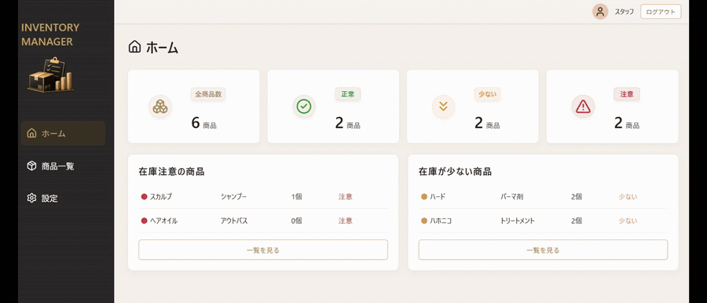

## アプリURL

[INVENTORY MANAGER](https://inventory-manager-app.com)

## 目次

- [概要](#概要)
- [制作背景](#制作背景)
- [要件定義](#要件定義)
- [機能一覧](#機能一覧)
- [主な使用技術](#主な使用技術)
- [️技術選定理由](#技術選定理由)
- [️画面遷移図](#画面遷移図)
- [インフラ構成図](#インフラ構成図)
- [DB設計](#DB設計)
- [ER図](#ER図)
- [APIのURL設計](#APIのURL設計)
- [機能紹介](#機能紹介)
    - [1. ユーザー新規登録機能](#1-ユーザー新規登録機能)
    - [2. ログイン・ログアウト機能](#2-ログインログアウト機能)
    - [3. ゲストログイン機能](#3-ゲストログイン機能)
    - [4. 商品管理機能（管理者・マネージャーのみ）](#4-商品管理機能管理者マネージャーのみ)
    - [5. カテゴリ管理機能（管理者・マネージャーのみ）](#5-カテゴリ管理機能管理者マネージャーのみ)
    - [6. 在庫数変更機能](#6-在庫数変更機能)
    - [7. 注意在庫確認機能](#7-注意在庫確認機能)
    - [8. 商品検索・絞り込み・並び替え機能](#8-商品検索絞り込み並び替え機能)
    - [9. ユーザー情報変更機能](#9-ユーザー情報変更機能)
    - [10. 権限管理機能（管理者のみ）](#10-権限管理機能管理者のみ)
- [工夫した点](#工夫した点)
- [苦労した点](#苦労した点)
- [今後の実装予定](#今後の実装予定)

## 概要

店舗で使用する商品の在庫を管理するWebアプリです。

商品ごとの在庫数を簡単に確認・更新できるほか、
設定した基準値を下回った商品を在庫注意として確認できるようにすることで、
発注が必要な商品の見落としを防ぎ、店舗の在庫管理を効率化します。

## 制作背景

美容師として働く中で、在庫確認や発注作業に手間がかかることに加え、
在庫が少なくなっていることに気づくのが遅れ、
商品が必要になったタイミングで在庫切れが発覚し、その際に他店舗へ
商品を借りに行くこともあり、在庫管理の非効率さを課題に感じていました。

そこで、商品の在庫数を簡単に確認・更新でき、
在庫が少なくなった商品を把握できる在庫管理アプリを制作しました。

## 要件定義

- 目的 : 店舗の在庫を把握し、在庫不足を防止する
- 想定ユーザー : 店舗の管理者 / マネージャー / スタッフ

詳細は[要件定義書](docs/要件定義書.md)を参照ください。

## 機能一覧

| No. | 機能                     |                            |
|-----|------------------------|----------------------------|
| 1   | ユーザー新規登録機能             | [詳細](#1-ユーザー新規登録機能)        |
| 2   | ログイン・ログアウト機能           | [詳細](#2-ログインログアウト機能)       |
| 3   | ゲストログイン機能              | [詳細](#3-ゲストログイン機能)         |
| 4   | 商品管理機能(管理者・マネージャーのみ)   | [詳細](#4-商品管理機能管理者マネージャーのみ) |
| 5   | カテゴリ管理機能(管理者・マネージャーのみ) | [詳細](#5-カテゴリ管理機能管理者マネージャーのみ) 
| 6   | 在庫数変更機能 | [詳細](#6-在庫数変更機能) |
| 7   | 注意在庫確認機能               | [詳細](#7-注意在庫確認機能)          |
| 8   | 商品検索・絞り込み・並び替え機能       | [詳細](#8-商品検索絞り込み並び替え機能)    |
| 9   | ユーザー情報変更機能             | [詳細](#9-ユーザー情報変更機能)        |
| 10  | 権限管理機能(管理者のみ)          | [詳細](#10-権限管理機能管理者のみ)      |

## 主な使用技術

### バックエンド

- Java 21 / Spring Boot 4.1.0

### フロントエンド

- React 19.2.8 / Node.js 24.19.0 / JavaScript / CSS

### インフラ・DB

AWS

- Amazon VPC (仮想ネットワーク)
- Amazon EC2 (Amazon Linux 2023)
- Amazon RDS for MySQL (データベース)
- Amazon S3 (JARファイルの保存)
- AWS Systems Manager (コマンド実行・EC2接続)
- Elastic Load Balancer (ALB：HTTPS終端・EC2への転送・HTTPからHTTPSへのリダイレクト)
- AWS Certificate Manager (SSL証明書の発行・管理)
- AWS IAM (アクセス権限管理)

その他

- Netlify (フロントエンドのホスティング・自動デプロイ)
- XServer Domain (ドメイン・DNS設定)
- MySQL (ローカル開発環境)

### 認証・認可

- Spring Security

### データアクセス

- Spring Data JPA

### 開発環境・ツール

- Postman
- Git
- GitHub
- GitHub Actions
- Visual Studio Code / IntelliJ IDEA

## 技術選定理由

### Spring Boot

Javaでのバックエンド開発を学習することを目的として採用しました。
またSpring Bootを通してREST APIの構築や、
Spring Securityを利用した認証・認可の仕組みを理解したいと考え採用しました。

### React

フロントエンド技術について調べる中で、Reactが広く利用されていることを知り、
実務で使用される機会が多い技術を学びたいと考え採用しました。
またコンポーネント単位でUIを管理できるため、
商品一覧やモーダルなどを整理しやすくなると思ったのも採用理由です。

## 画面遷移図

アプリ全体の画面遷移と、各画面から開くモーダルをまとめています。
<details>
<summary>画面遷移図を表示</summary>

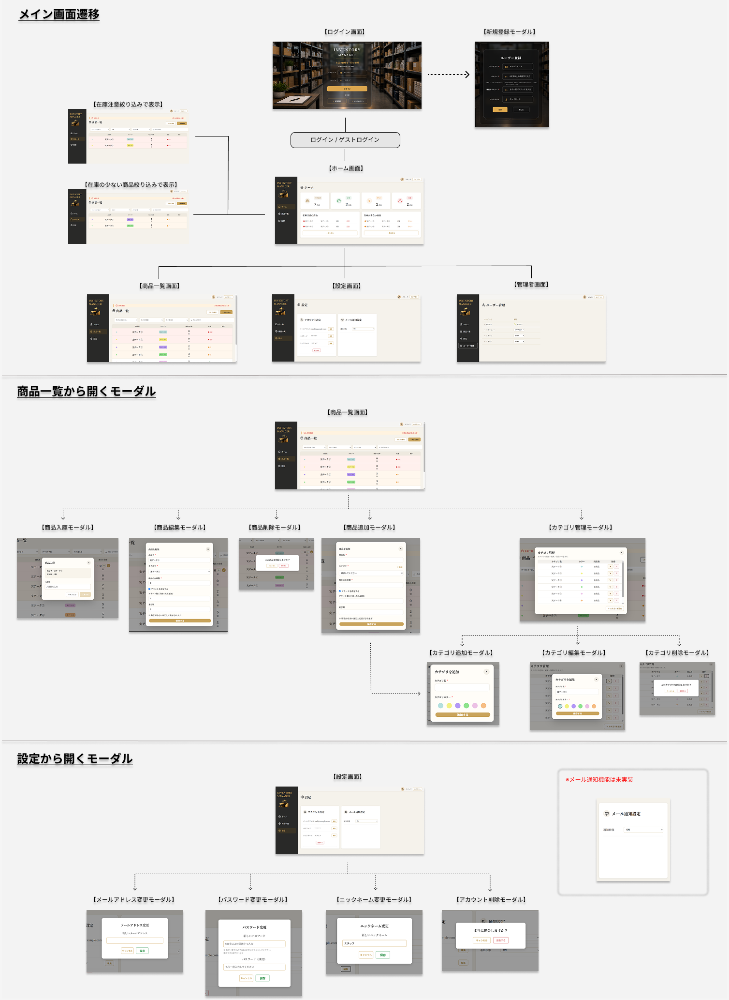

</details>

## インフラ構成図

<details>
<summary>インフラ構成図を表示</summary>

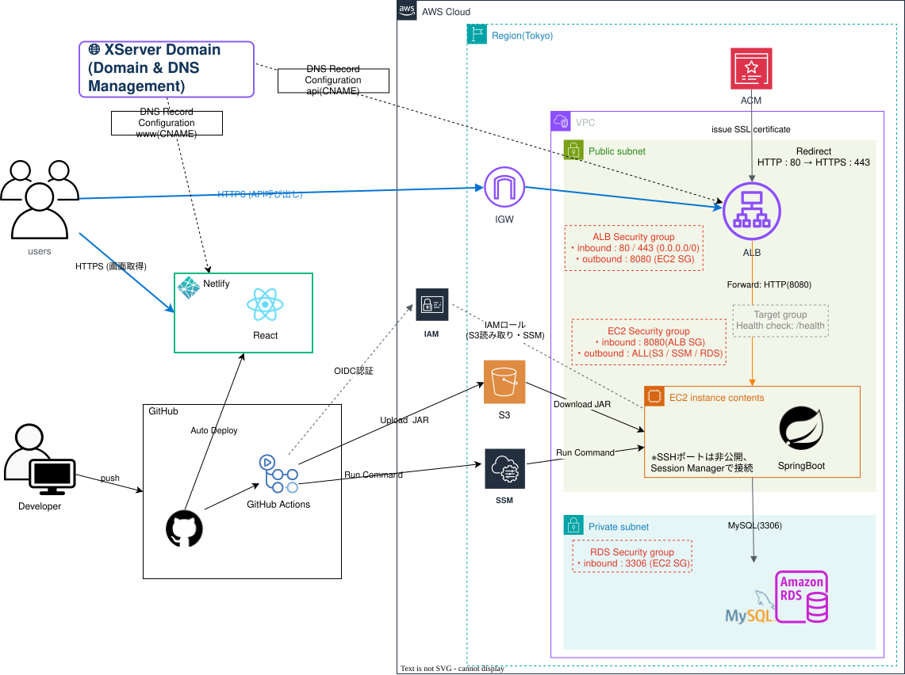

</details>

## DB設計
<details>
<summary>DB設計を表示</summary>

### users

| カラム           | 内容           |
|---------------|--------------|
| id            | 主キー          |
| email         | メールアドレス      |
| password_hash | ハッシュ化したパスワード |
| role          | 権限           |
| nickname      | ニックネーム       |

### categories

| カラム        | 内容        |
|------------|-----------|
| id         | 主キー       |
| name       | カテゴリ名     |
| color_code | カテゴリカラー   |
| sort_order | 表示順       |
| is_demo    | デモデータかどうか |
| guest_id   | ゲストユーザーID |

### items

| カラム           | 内容         |
|---------------|------------|
| id            | 主キー        |
| name          | 商品名        |
| category_id   | カテゴリID     |
| current_stock | 現在の在庫数     |
| alert_enabled | アラートON/OFF |
| min_stock     | アラート基準値    |
| sort_order    | 商品の並び順     |
| is_demo       | デモデータかどうか  |
| guest_id      | ゲストユーザーID  |

</details>

## ER図
<details>
<summary>ER図を表示</summary>

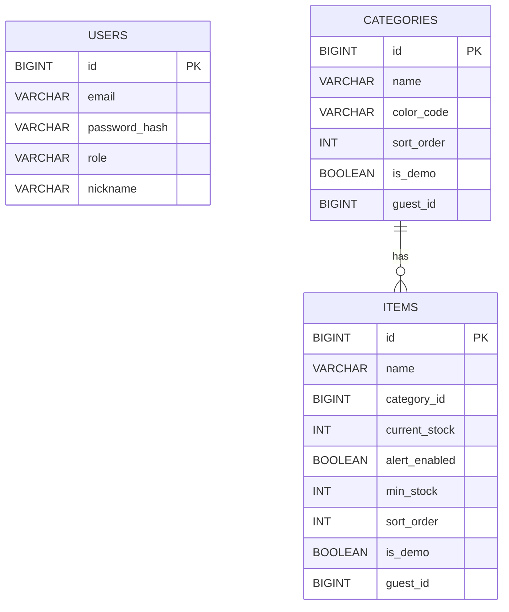

###### 単一店舗での利用を想定しているため、通常の商品・カテゴリは店舗内で共有して管理します。
###### 一方、Web上でのデモ利用では複数ユーザーが同時に利用する可能性を考慮し、is_demo と guest_id によってゲストごとのデモデータを識別・分離しています。

</details>

### 認証方式

Spring Securityによるセッション認証を使用しています。
ログイン時に認証情報をセッションに保存し、
以降のAPIリクエストではセッションCookieを利用して認証状態を管理します。
パスワードはBCryptでハッシュ化して保存しています。

## APIのURL設計
<details>
<summary>API一覧を表示</summary>

### 商品API

| HTTPメソッド | URL                     | 処理内容   |
|----------|-------------------------|--------|
| GET      | `/api/items`            | 商品一覧取得 |
| POST     | `/api/items`            | 商品登録   |
| PUT      | `/api/items/{id}`       | 商品更新   |
| DELETE   | `/api/items/{id}`       | 商品削除   |
| PATCH    | `/api/items/{id}/stock` | 在庫数更新  |

### カテゴリAPI

| HTTPメソッド | URL                    | 処理内容     |
|----------|------------------------|----------|
| GET      | `/api/categories`      | カテゴリ一覧取得 |
| POST     | `/api/categories`      | カテゴリ登録  |
| PUT      | `/api/categories/{id}` | カテゴリ更新  |
| DELETE   | `/api/categories/{id}` | カテゴリ削除  |

### 認証・ユーザーAPI

| HTTPメソッド | URL                   | 処理内容      |
|----------|-----------------------|-----------|
| POST     | `/api/auth/login`     | ログイン      |
| POST     | `/api/auth/logout`    | ログアウト     |
| POST     | `/api/auth/register`  | ユーザー登録    |
| PATCH    | `/api/auth/email`     | メールアドレス変更 |
| PATCH    | `/api/auth/password`  | パスワード変更   |
| PATCH    | `/api/auth/nickname`  | ニックネーム変更  |
| PATCH    | `/api/auth/{id}/role` | ユーザー権限変更  |
| GET      | `/api/auth/users`     | ユーザー一覧取得  |
| DELETE   | `/api/auth`           | ユーザー削除    |

### ゲストAPI

| HTTPメソッド | URL                 | 処理内容     |
|----------|---------------------|----------|
| POST     | `/api/guest/login`  | ゲストログイン  |
| POST     | `/api/guest/logout` | ゲストログアウト |

</details>

## 機能紹介

### 1. ユーザー新規登録機能
| ユーザー新規登録フロー |
|:---:|
| 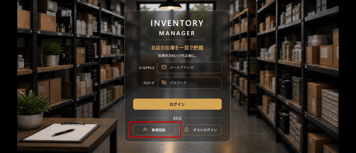 |

- メールアドレス、パスワード、ニックネームで新規登録を行います。
- パスワードはハッシュ化してDBに保存されます。

#### フォームバリデーション
| 項目 | 内容                                                              |
|----------|-----------------------------------------------------------------|
|メールアドレス    | ・入力必須<br/> ・メールアドレス形式（@を含む、254字以内）<br/>・重複不可                    |
| パスワード    | ・入力必須<br/>・英字と数字を各1字以上含む、6~32字の半角英数字・記号（! @ #）<br/>・確認用パスワードと一致 | 
| ニックネーム    | ・入力必須<br/>・20字以内                                                |

### 2. ログイン・ログアウト機能
| ログインフロー |
|:---:|
|  |

- 登録したメールアドレスとパスワードでログインします。
- 認証・認可にはSpring Securityを使用しています。

### 3. ゲストログイン機能
|                          ゲストログインフロー                          |
|:------------------------------------------------------------:|
| 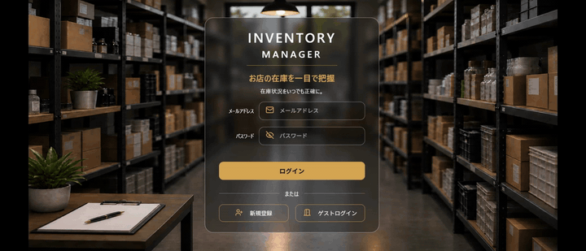 |

- ユーザー登録をすることなく、アプリをお試しいただくことができます。
- ゲストユーザーごとにゲストアカウントとデモデータを作成し、
  商品・カテゴリにゲストユーザーIDを紐づけることで、
  複数のゲストユーザーが同時に利用してもデータが干渉しないようにしています。

<details>
<summary>実装コード</summary>

```java
public void createDemoData(Long guestId) {
  Map<Long, Category> categoryMap = createDemoCategories(guestId);

  createDemoItems(categoryMap, guestId);
}

private Map<Long, Category> createDemoCategories(Long guestId) {
  // 実際のデータのカテゴリを取得
  List<Category> realCategories =
      categoryRepository.findAllByIsDemoAndGuestId(false, null);

  List<Category> demoCategories = new ArrayList<>();
  Map<Long, Category> categoryMap = new HashMap<>();

  for (Category realCategory : realCategories) {
    Category demoCategory = new Category();

    demoCategory.setName(realCategory.getName());
    demoCategory.setColorCode(realCategory.getColorCode());

    // ゲストごとのデモデータとして登録
    demoCategory.setIsDemo(true);
    demoCategory.setGuestId(guestId);

    demoCategories.add(demoCategory);

    // 元カテゴリIDとデモカテゴリを対応付け
    categoryMap.put(realCategory.getId(), demoCategory);
  }
  categoryRepository.saveAll(demoCategories);
  return categoryMap;
}

private void createDemoItems(Map<Long, Category> categoryMap, Long guestId) {
  // 実際のデータの商品を取得
  List<Item> realItems =
      itemRepository.findAllByIsDemoAndGuestIdOrderBySortOrderAsc(false, null);

  List<Item> demoItems = new ArrayList<>();

  for (Item realItem : realItems) {
    Item demoItem = new Item();

    demoItem.setName(realItem.getName());
    demoItem.setCurrentStock(realItem.getCurrentStock());
    demoItem.setAlertEnabled(realItem.getAlertEnabled());
    demoItem.setMinStock(realItem.getMinStock());
    demoItem.setSortOrder(realItem.getSortOrder());
    demoItem.setIsDemo(true);
    demoItem.setGuestId(guestId);

    // ゲスト用カテゴリに紐付け
    Category demoCategory = categoryMap.get(realItem.getCategory().getId());

    demoItem.setCategory(demoCategory);

    demoItems.add(demoItem);
  }

  itemRepository.saveAll(demoItems);
}
```

</details>

#### ゲストデータの削除機能

- ログアウト時には、対象のゲストIDに紐づく、デモ商品・デモカテゴリ・ゲストアカウントを削除し、不要なデータが残らないようにしています。
- 最終アクセスから60分以上経過したゲストユーザーも、10分ごとの定期実行処理で自動削除します。

##### 1. 削除処理

<details>
<summary>実装コード</summary>

```java
// ログアウト時に、現在のゲストのデモデータとアカウントを削除
@Transactional
public void deleteCurrentGuestData() {
  // 現在ログインしているゲストのIDを取得
  Long guestId = getCurrentGuestId();

  deleteDemoData(guestId);
}

@Transactional
public void cleanupExpiredGuest() {
  // 60分前の日時を取得
  LocalDateTime threshold = LocalDateTime.now().minusMinutes(60);

  // 最終アクセスから60分以上経過したゲストを取得
  List<Users> expiredGuest =
      usersRepository.findByRoleAndLastAccessedAtBefore("GUEST", threshold);

  // 対象ゲストごとにデモデータとアカウントを削除
  for (Users guest : expiredGuest) {
    deleteDemoData(guest.getId());
  }
}

@Transactional
public void deleteDemoData(Long guestId) {
  // 対象ゲストの商品を削除
  itemRepository.deleteAllByIsDemoAndGuestId(true, guestId);

  // 対象ゲストのカテゴリを削除
  categoryRepository.deleteAllByIsDemoAndGuestId(true, guestId);

  // ゲストアカウントを削除
  usersRepository.deleteById(guestId);
}
```

</details>

##### 2. 定期実行処理

<details>
<summary>実装コード</summary>

```java
// 期限切れゲストの削除処理を定期実行する
@Component
@RequiredArgsConstructor
public class GuestCleanupScheduler {

  private final GuestService guestService;

  // 10分ごとに期限切れゲストの削除処理を実行
  @Scheduled(fixedRate = 10 * 60 * 1000)
  public void cleanupExpiredGuest() {
    guestService.cleanupExpiredGuest();
  }
}
```

</details>

### 4. 商品管理機能(管理者・マネージャーのみ)
|                    商品登録・編集フロー                          |
|:------------------------------------------------------:|
|  |

- 商品の追加・編集・削除ができます（商品名、カテゴリ、在庫数、アラート設定、並び順）。
- 同じ商品名は登録できず、削除の前には、確認モーダルを表示します。

### 5. カテゴリ管理機能(管理者・マネージャーのみ)
|                   カテゴリ登録・編集フロー                          |
|:------------------------------------------------------:|
| 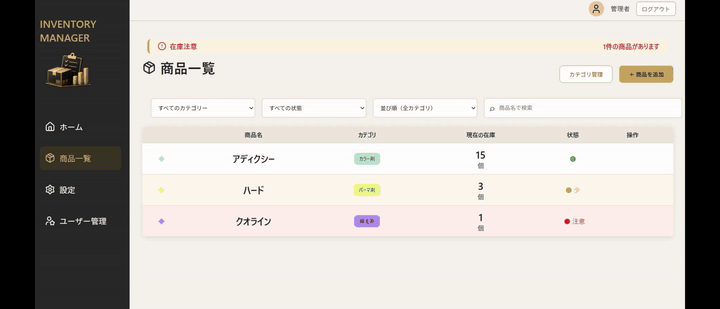 |

- カテゴリの追加・編集・削除ができます。カテゴリごとに、6色から色を選べます。
- 同じカテゴリ名は登録できず、商品が登録されているカテゴリは、削除できません。
- カテゴリごとの商品数を、一覧で確認できます。

### 6. 在庫数変更機能
|                         在庫数変更フロー                         |
|:--------------------------------------------------------:|
| 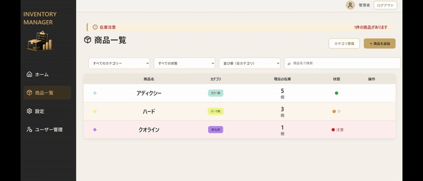 |

- 入荷時は、「入庫」ボタンから入庫数を入力して、在庫を加算できます。
- 商品を選び、「−」「＋」で増減量を調整して、「決定」で確定します。誤操作を防ぐため、変更内容を確認してから確定する仕組みにしています。[詳細](#誤操作を防ぐ在庫変更)
- STAFF権限のユーザーは、在庫を減らす操作だけができます。

<details>
<summary>実装コード</summary>

（フロントエンド側）STAFFには「＋」ボタンを非表示
```jsx
{isSelected && user?.role !== "STAFF" && (
  <button className="stock-control  stock-plus" ...>＋</button>
)}
```
（バックエンド側）STAFFが在庫を増やそうとしたら403を返す
```java
boolean isStaff = false;

 for (GrantedAuthority authority :
        SecurityContextHolder.getContext().getAuthentication().getAuthorities()) {
   if ("ROLE_STAFF".equals(authority.getAuthority())) {
     isStaff = true;
     break;
   }
 }
 if (isStaff && newStock > item.getCurrentStock()) {
   throw new ResponseStatusException(HttpStatus.FORBIDDEN);
 }
```
</details>

### 7. 注意在庫確認機能
|                   注意在庫確認フロー                          |
|:------------------------------------------------------:|
| 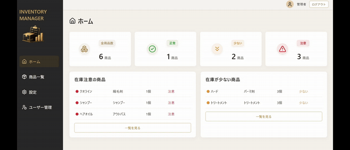 |

- 在庫数とアラート基準値から、状態を3段階（正常、少ない、注意）で色分けして表示します。
- ホーム画面では、状態ごとの件数と、注意・少ない商品を確認でき、「一覧を見る」から、その状態で絞り込んだ商品一覧へ移動します。

<details>
<summary>実装コード</summary>

```javascript
export const getStockStatus = (item) => {
  const stock = item.currentStock;
  const alert = item.minStock;

  //アラート基準値＋3個以上：正常
  if (stock >= alert + 3) {
    return { status: "正常",/* ... */ };
  }
  // アラート基準値＋1〜2個：少ない
  if (stock > alert) {
    return {status: "少ない",/* ... */};
  }
  //アラート基準値以下（アラート設定がONのとき）:注意  
  if (item.alertEnabled === true) {
    return {status: "注意",/* ... */};
  }
  //アラート基準値以下（アラート設定がOFFのとき）:少ない  
  return {status: "少ない",/* ... */};
};

```
</details>


### 8. 商品検索・絞り込み・並び替え機能
|                   商品検索・絞り込み・並び替えフロー                          |
|:------------------------------------------------------:|
| 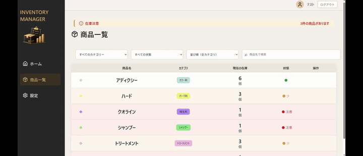 |

- カテゴリ・状態での絞り込みと、商品名での検索（部分一致）を、組み合わせて使えます。
- 並び替えは、並び順（カテゴリ別・全カテゴリ）や、在庫数の多い順・少ない順ができます。


### 9. ユーザー情報変更機能
|                   ユーザー情報変更フロー                          |
|:------------------------------------------------------:|
| 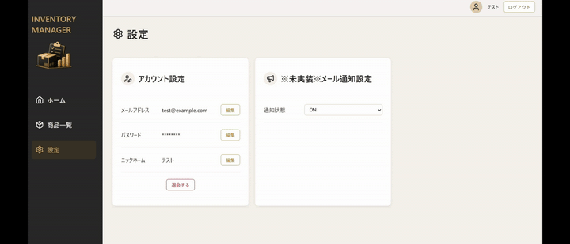 |

- 設定画面で、メールアドレス・パスワード・ニックネームの変更と、退会ができます。
- メールアドレスが重複する場合は変更はできません。

### 10. 権限管理機能(管理者のみ)
|                          権限変更フロー                           |
|:----------------------------------------------------------:|
| 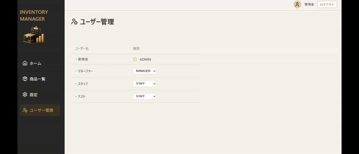 |

- 管理者のみユーザー管理画面にて、他ユーザーの権限をMANAGERまたはSTAFFに変更することができます。

<details>
<summary>実装コード</summary>

（認可設定：SecurityConfig）

```java
//権限管理は管理者のみ
.requestMatchers(HttpMethod.GET, "/api/auth/users").hasRole("ADMIN")
.requestMatchers(HttpMethod.PATCH, "/api/auth/*/role").hasRole("ADMIN")
```

（管理者の重複登録禁止：UsersService）
```java
//既存管理者の変更禁止
if ("ADMIN".equals(users.getRole())) {
  throw new IllegalArgumentException("ADMIN_CANNOT_CHANGE");
}
//管理者の重複防止
if ("ADMIN".equals(role) && usersRepository.existsByRole("ADMIN")) {
  throw new IllegalArgumentException("ADMIN_ALREADY_EXISTS");
}
```
</details>

## 工夫した点

### 在庫数を直感的に確認できるUI

在庫数だけでなく、在庫状況を視覚的に把握できるように、
在庫数に応じて表示を変えるUIを実装しました。
在庫状況を「正常」「少ない」「注意」の3段階で視覚的に把握できるようにしています。

### 誤操作を防ぐ在庫変更

在庫数を増減する操作では、変更内容を確認してから確定できるようにし、
誤操作による在庫数の変更を防止しています。

<details>
<summary>実装コード</summary>

```javascript
const [stockChange, setStockChange] = useState(0);

const handleStockChange = async (item, newStock) => {
  const updatedStock = await updateStockApi(item, newStock);

  onUpdateStock(updatedStock);
};
// ...

// 在庫を減らす
setStockChange((prev) => Math.max(prev - 1, -item.currentStock));
// ...

// 在庫を増やす
setStockChange((prev) => prev + 1);
// ...

// 決定ボタンで変更を確定
if (stockChange !== 0) {
  handleStockChange(item, item.currentStock + stockChange);
}
// ...
```

</details>

### 効果的なバリデーションと例外処理

#### 1. フロントとバックエンドの二重バリデーション

- フロントエンド : 新規登録、メールアドレス・パスワード・ニックネーム変更で、入力形式や文字数を送信前にチェックし、
  必須項目の未入力、パスワードと確認用の不一致も検出できるようにしました。


- バックエンド : Bean Validation(`@NotBlank` / `@Pattern` / `@Min` / `@Valid`)で、
  APIに直接リクエストされた場合にも不正な入力を防止するようにしました。

#### 2. 状況に応じたHTTPステータスの使い分け

- 想定される例外を適切なHTTPステータスコードに変換し、
  エラーの種類に応じたレスポンスを返すようにしました。

| ステータス | 用途                                                                                                       |
|-------|----------------------------------------------------------------------------------------------------------|
| 400   | 入力値の形式不正・必須項目の未入力（Bean Validation）                                                                       |
| 401   | 未ログイン・認証失敗・セッション切れ                                                                                       |
| 403   | ロールによる権限不足                                                                                               |
| 404   | 対象の商品・カテゴリ・ユーザーが存在しない                                                                                    |
| 409   | 商品名・カテゴリ名・メールアドレスの重複<br/>商品が登録されているカテゴリの削除<br/>現在と同じパスワードへの変更<br/>すでに管理者がいる状態での管理者への権限変更 <br/>既存管理者の権限変更 |
| 422   | 新規登録時のパスワードと確認用の不一致                                                                                      |

#### 3. エラーメッセージの表示と認証エラーへの対応

- HTTPステータスコードに応じて、フロントエンドではエラーメッセージを表示するようにしました。
  また、セッション切れなどで認証エラーが発生した場合は、
  ログイン状態を解除してログイン画面へ切り替え、再ログインを促すようにしました。

## 苦労した点

### 画面構成の見直し

#### 【問題】

はじめは、商品一覧画面のみの構成で設計していましたが、
商品一覧画面を作り終えて実際に自分で使ってみると、
在庫が少ない商品状況の確認やユーザー設定などの機能を商品一覧画面だけで管理するよりも、
画面を分けたほうが使いやすいと感じました。

#### 【解決策】

商品一覧画面だけでなく、ホーム画面・商品一覧・設定・ユーザー管理（adminのみ）の
4画面に分け、各画面へ移動しやすいようにサイドバーを追加しました。

### ゲストログインの設計変更

#### 【問題】

はじめは、1つのゲストアカウントを複数のユーザーで共有する設計にしていました。

ですが、Web上で公開することを考えると、 複数のユーザーが同時にゲストログインした場合、
同じデータを操作することでデータが干渉する可能性があると思いました。

#### 【解決策】

ゲストログインするたびにゲストアカウントを作成し、 ゲストユーザーごとにデモデータを作成する設計へ変更しました。

商品・カテゴリにゲストユーザーIDを紐づけることで、
複数のゲストユーザーが同時に利用しても、それぞれ独立したデモデータを操作できるようにしました。

また、ログアウト時にはゲストユーザーと紐づくデモデータを削除することで、
不要なデータが残らないようにしています。

### Spring Security導入後のエラー処理

#### 【問題】

ユーザー登録・ログイン時のエラーを、状況に応じて適切なHTTPステータス（409・401・400）として返すようにしましたが、
まずメールアドレス重複時に409 Conflictを返す実装をしたところ、実際には403 Forbiddenが返る問題が発生しました。

#### 【原因】

メールアドレス重複時だけでなく、ログイン認証失敗時や新規登録時の入力エラーでも403 Forbiddenが返っていたため、
まずCSRFを無効にして検証しましたが、403は解消されませんでした。
そこで、Spring Securityの詳細ログを有効にし、アクセス制御の処理を調べました。
その結果、 エラー処理後の/errorへのアクセスが拒否されていることが分かりました。

#### 【解決策】

/errorをpermitAll()の対象に追加することで、エラー処理時のアクセス拒否を解消しました。
その結果、状況に応じて適切なHTTPステータスを返せるようになりました。

- メールアドレス重複 → 409 Conflict
- ログイン認証失敗 → 401 Unauthorized
- 新規登録時のメールアドレス重複以外の入力エラー → 400 Bad Request

Spring Securityでは、Controllerで発生したエラーだけでなく、エラー処理に使用される/errorへのアクセスにもセキュリティ設定が適用されることを学びました。
また、詳細ログを活用して原因を切り分けることの重要性を実感しました。

## 今後の実装予定

### 設定画面の通知設定

メール通知機能を実装予定です。

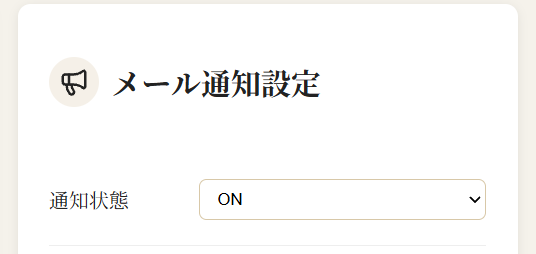